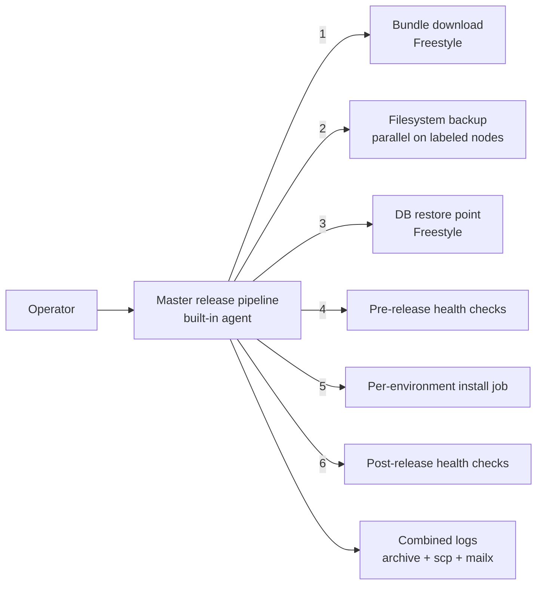

# Jenkins Advanced CI/CD Automations

Jenkins pipelines and shell automation I designed and built to run controlled release installations on a multi-node, Oracle-backed enterprise platform. The work replaces a manual, error-prone release runbook with auditable, parameterised jobs that validate the environment, take rollback points, deploy, and verify.

> This repository is a sanitised portfolio version of work delivered for a client. Hostnames, e-mail addresses, internal URLs, environment names, and file-server details were removed or replaced with configuration variables. Nothing here connects to a real system.

## What it does

| Capability | Implementation |
|------------|----------------|
| Release orchestration | A declarative master pipeline chains six gated stages (download, backup, DB restore point, pre-checks, install, post-checks) and propagates parameters to downstream jobs |
| Rollback safety | Parallel filesystem backup with `pigz`, Oracle guaranteed restore points (Flashback Database), and a matching restore pipeline |
| Pre-flight validation | Agent availability, free disk space, and archive presence are checked on every node before any destructive step |
| Health verification | Checks for disk, memory, Oracle latency, tablespaces, long-running SQL, and application state, each scored PASS / WARN / FAIL with a go/no-go summary |
| Artifact integrity | Bundle download over HTTPS with optional `cksum` validation that fails fast on a missing or mismatched checksum |
| Auditability | Timestamped logs per stage, merged into one report per run, archived in Jenkins, and mailed to the build user |

## Architecture



Each stage is a separate Jenkins job, so it can run on its own (for example, a backup without a release) and be changed without touching the orchestrator. Stages are switched on or off with boolean parameters.

## Repository layout

```
.
├── jenkins/pipelines/
│   ├── MasterReleaseInstallation.groovy   # Orchestrator (declarative pipeline)
│   ├── FileSystemApplicatonBackup.groovy  # Parallel backup across labeled agents
│   ├── FileSystemApplicatonRestore.groovy # Parallel restore with pre-validation
│   ├── DBRestorePointManagement.sh        # List / create / drop Oracle restore points
│   ├── download_bundle.sh                 # Download + checksum validation
│   └── PrePost_Jenkins_Job.sh             # Health checks driven by Jenkins parameters
├── scripts/PrePostReleaseScript/          # Standalone health checks (manual run)
└── docs/REFERENCE.md                      # Per-job parameters, variables, and runbooks
```

## Engineering decisions

- **Fail early.** Parameters, node availability, disk space, and checksum inputs are validated before the first change is made. A missing input stops the build in seconds instead of halfway through an install.
- **Parallel by label.** Backup and restore fan out to every agent carrying the environment label, so the run takes as long as the slowest node. `pigz` replaces `gzip` for multi-core compression.
- **Single evidence trail.** Per-node logs are stashed, merged into one report, and archived. This gives auditors and reviewers one file per run.
- **Small, composable jobs.** The orchestrator only calls jobs by name and passes parameters. Environment-to-node and environment-to-job mappings live in one map in the pipeline.
- **No environment data in code.** Hosts, users, recipients, and paths come from environment variables (see below). Secrets such as `SFTP_USER` are expected from Jenkins credentials or node configuration.
- **Explicit blast radius.** The restore pipeline removes application directories by design. The docs state this and the pipeline checks the archive exists before deleting anything.

## Configuration

The master pipeline and the download job read these variables from the Jenkins controller or node environment.

| Variable | Used by | Purpose | Default |
|----------|---------|---------|---------|
| `LOG_HOST`, `LOG_HOST_USER`, `LOG_REMOTE_DIR` | Master pipeline | Host, user, and directory that receive the run logs and send the e-mail | `log-host.example.com`, `app_user`, `/opt/app/workspace/INSTALL_RELEASE` |
| `MAIL_FROM` | Master pipeline | Sender of the summary e-mail | `Release Automation <jenkins@example.com>` |
| `NOTIFY_EXTRA_EMAIL` | Master pipeline | Optional extra recipient besides the build user | none |
| `SFTP_HOST`, `SFTP_USER` | `download_bundle.sh` | SFTP/HTTPS host (no scheme) and user. `SFTP_HOST` is required | none |
| `ATA_HOME`, `ORACLE_SID`, `ATASVRCONNECT` | Backup, restore, restore points | Application root and Oracle connection on each agent | none |

Jenkins prerequisites: Copy Artifact and Build User Vars plugins, agents labeled per environment, passwordless SSH from the controller to the log host.

## Stack

Jenkins (Declarative Pipeline, Groovy, Freestyle), Bash and Korn shell, Oracle (`sqlplus`, `tnsping`, Flashback Database), `pigz`, `curl`, `ssh`/`scp`, `mailx`, Linux.

## Documentation

- [`docs/REFERENCE.md`](docs/REFERENCE.md): parameters, variables, artifacts, and setup steps for every job.
- [`scripts/PrePostReleaseScript/README.md`](scripts/PrePostReleaseScript/README.md): health-check catalogue, topology matrix, and troubleshooting.

## Known limitations

- Pipelines target a specific application layout (`ATA_HOME` and vendor CLI tools such as `da_dump`, `cfg`, `svstatus`), so they will not run unchanged elsewhere.
- `download_bundle.sh` uses `curl -k`, which skips TLS verification. Replace it with a trusted CA bundle before reuse.
- There are no automated tests in this repository.

## Author

Luis Cabezas ([@IngLuisCabezas](https://github.com/IngLuisCabezas)).
